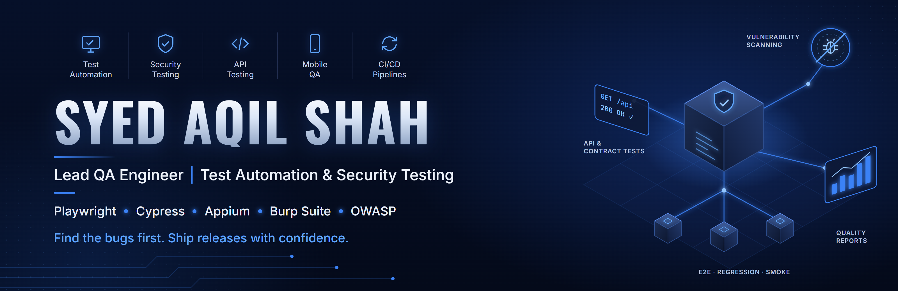

## About me

I'm a **QA and security engineer with 4+ years of experience** making web and mobile products reliable and hard to break. I currently lead QA for a homebuilder ERP platform used in Ontario, Canada, where I own test planning, regression, release sign-off and API checks across sales, contracts and design-studio workflows.

My work sits where **test automation meets offensive security**: I build Playwright, Cypress and Nightwatch suites that run in CI, and I bring a pentester's mindset (OWASP Top 10, API abuse, Android APK review) to every feature I test, so defects and vulnerabilities are caught before release, not after.

**What I bring to a team**

- 🎯 **Release confidence:** risk-based test strategy, clear bug reports with evidence, and fast regression on every PR environment
- 🤖 **Automation that lasts:** Page Object Model suites, API automation, Dockerised runs and scheduled GitHub Actions pipelines
- 🔐 **Security built into QA:** web and mobile VAPT, Burp Suite, MobSF, auth and access-control testing
- 🤝 **Ownership beyond testing:** QA documentation, requirement clarification, and project coordination with developers and clients

> 🔎 **Interested in:** QA Automation, SDET and Application Security Testing roles.

---

## Experience

| Role | Company | Period |
|---|---|---|
| **Lead QA Engineer** | Zayan Technologies (Canada, remote) | Apr 2026 – Present |
| **Automation & Security Engineer** | E-Conceptions | May 2025 – Apr 2026 |
| **QA Engineer · Security Testing · Project Management** | WorkBox SMC Pvt Ltd | Jun 2022 – Jun 2025 |
| **QA Engineer** (remote) | DevEntia | Jun 2023 – Dec 2023 |

<b>Highlights</b>

 

- **Homebuilder ERP (Canada):** lead QA across deals, contracts, addenda, design-studio options and reporting; manual, API, automation and security testing with full release validation.
- **Streaming & e-commerce (Tamasha, DealO):** security assessments plus automated web regression suites.
- **Telecom ISP services:** Dockerised Level-1 service automation scheduled through GitHub Actions with alerting.
- **Shipping platform (Secureship, Canada/US):** led testing and managed delivery timelines as QA engineer and PM.
- **API platform (Hestia Solutions, TM Forum):** Open API test automation with Cypress and Docker.
- **Online pet pharmacy (Allivet):** web penetration testing.
- **Mobile apps (healthcare, tutoring):** Android automation with Nightwatch and Appium; QA lead on a tutoring app.

---

## Tech stack

**Test automation** 

**Security testing** 

**CI/CD & tooling** 

**Languages** 

**Process & tracking** 

---

## Featured work

| Project | What it shows |
|---|---|
| [**Transmit-E2E**](https://github.com/syed-aqil/Transmit-E2E) | Playwright end-to-end suite for a multi-tenant admin portal: Page Object Model, env-based secrets, saved auth sessions and state carried between runs |
| **Web & API regression suites** *(private, client work)* | Playwright and Cypress suites with API automation, run in Docker and scheduled through GitHub Actions |
| **Mobile automation** *(private, client work)* | Android app automation with Nightwatch and Appium for healthcare and media apps |

> Most of my work is under NDA in private client repositories. I'm happy to walk through code samples and test strategy in an interview.

---

## Certifications

| | Certification | Issuer |
|---|---|---|
| 🛡️ | Certified Cybersecurity Engineer | National Centre for Cybersecurity, Pakistan |
| 📋 | Agile Project Management | HP |
| 🤖 | Automation Engineer (Playwright & Nightwatch) | |
| 🐳 | Docker Essentials | Udemy |
| 🔐 | CNSP | *Exam scheduled* |
| ✅ | ISTQB Foundation | *In preparation* |

---

**Let's talk about quality and security.** 
[Portfolio](https://syedaqilshah.netlify.app) · [LinkedIn](https://linkedin.com/in/syed-aqil-shah) · [Email](mailto:aqilshah16@gmail.com)

